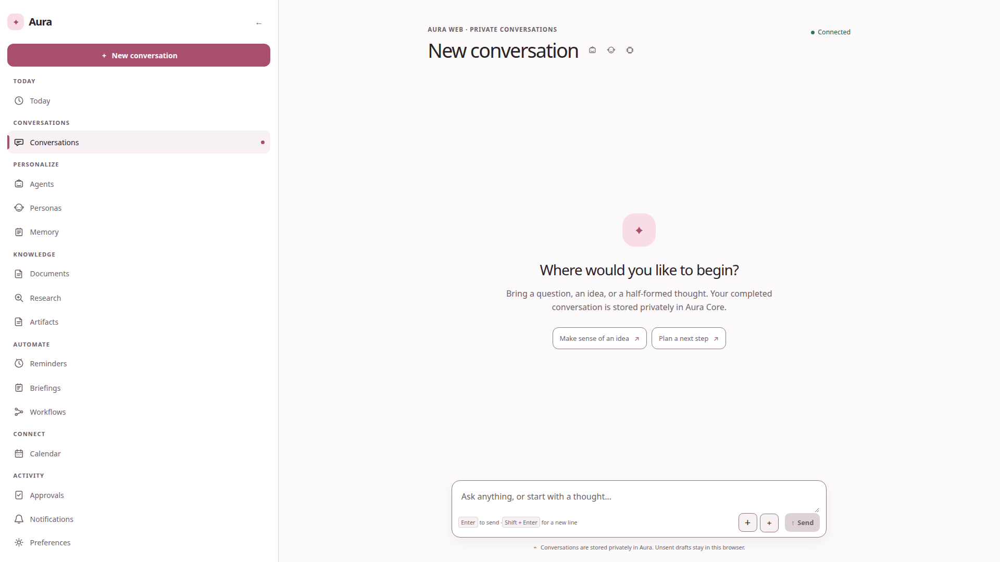
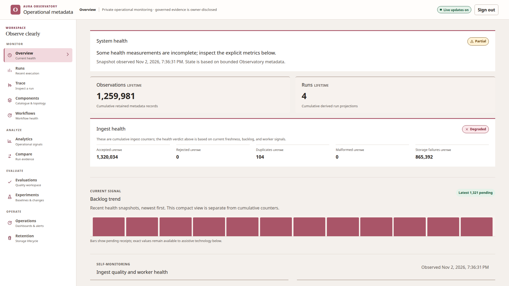

# Aura AI

> A local-first, governed model harness for private agents, provider selection, tool execution, memory, durable tasks, and evaluation — with a personal AI experience on top and a separate Observatory for operational metadata.

Aura is a model harness first and a personal AI product on top. It provides the
control plane for agent revisions, model and provider policies, bounded tool
execution, memory and knowledge context, durable work, and evaluation evidence,
without making the home, cloud, or a single chatbot provider the product
boundary. Aura Core owns the domain state and execution; Aura Web is the
responsive personal AI client; Aura Observatory is a separate monitoring and
evaluation product.

## See it in action

The current repository captures are sanitized 1920×1080 views of authenticated
product states. Aura Web shows a connected new-conversation workspace; Aura
Observatory shows a signed-in operational overview with sanitized operational
metadata. They contain no private conversations, credentials, tokens, or
provider content.

<figure>
  <a href="docs/assets/readme/aura-web.png"></a>
  <figcaption><strong>Aura Web</strong> — authenticated connected new-conversation workspace. <a href="docs/assets/readme/aura-web.png">Open the original 1920×1080 capture</a>.</figcaption>
</figure>

<figure>
  <a href="docs/assets/readme/aura-observatory.png"></a>
  <figcaption><strong>Aura Observatory</strong> — signed-in degraded-state example showing explicit health, backlog, and ingest diagnostics with sanitized metadata. <a href="docs/assets/readme/aura-observatory.png">Open the original 1920×1080 capture</a>.</figcaption>
</figure>

## What is implemented

### The model harness

- Governed agent identities and revisions with explicit model selection, tool
  policies, memory visibility, execution limits, and owner-scoped state.
- Shared execution paths for conversations, tools, scheduled work, workflows,
  and durable tasks, with cancellation, recovery, and versioned contracts.
- Local-first model and provider adapters, inspectable memory and knowledge,
  generated artifacts, and an evaluation/observability boundary where ordinary
  operational telemetry stays metadata-only; an owner deployment may explicitly
  enable bounded run-evidence export through a separate governed channel.

### Aura Web

- Private, authenticated conversations with streaming responses, safe Markdown,
  branching and editing flows, attachments, drafts, and model selection.
- Versioned agents and reusable personas, including enable/disable controls,
  revision history, tool policies, and memory-policy views.
- Inspectable memory with candidates and settings, plus a document library with
  owner-scoped processing and recovery states.
- Governed research, generated artifacts, and a durable Task Center at
  `/research`, `/artifacts`, and `/tasks`. Research exposes bounded provenance
  and citations; artifacts support text-oriented revisions, previews, downloads,
  integrity metadata, and explicit deletion; Task Center projects research,
  workflow, briefing, document, and memory-reindex work with progress and
  capability-gated cancel/retry actions.
- Daily action and automation surfaces for reminders, briefings, workflows,
  notifications, approvals, and calendar planning.
- Responsive themes, keyboard and focus handling, reduced-motion support, and
  recovery-oriented loading, empty, unauthorized, and unavailable states.

### Aura Observatory

Aura Observatory is an independent service with its own API, web application,
database, workers, scheduler, authorization boundary, migrations, and retention
policy. Its current surface covers owner-only operational metadata, component
health, run and trace inspection, evaluations, experiments, workflow monitoring,
dashboards, incidents, and retention operations. Observatory does not read Aura
Core tables directly.

### Important provider boundary

The governed research contracts and isolated static/browser fetcher services are
present, but research providers are operator-configured and disabled by default
in the local rollout. The quick start does not silently enable SearXNG, public
web egress, Playwright fetching, Home Assistant, or a cloud model. Fetched
content is treated as untrusted evidence and cannot change Aura instructions,
policies, tools, permissions, or budgets.

## Architecture at a glance

```text
Aura Web / Wall / external clients
                │
                ▼
        Aura Core modular monolith
        API · worker · scheduler · CLI
                │
      ┌─────────┴─────────┐
      ▼                   ▼
 provider adapters     versioned contracts
      │                   │
      └─────────┬─────────┘
                ▼
       Aura-owned state and events
                │
                │ governed metadata / evaluation jobs
                ▼
        Aura Observatory (separate)
```

Key boundaries:

- Aura Core is the harness control plane: domain-owned policies and state sit
  below thin HTTP, tool, worker, scheduler, and client entrypoints. Personal AI
  UX is one client of those shared execution paths, not a separate runtime.
- Domain modules own their rules, persistence, migrations, and public use cases;
  HTTP, tools, voice, workers, schedules, and workflows are thin entrypoints.
- PostgreSQL is the source of truth for Aura Core and Observatory separately.
  NATS JetStream carries durable events; Valkey is ephemeral coordination; Garage
  provides S3-compatible object storage.
- Python 3.14, FastAPI, SQLAlchemy, Alembic, and `uv` power the services. Aura
  Web uses strict TypeScript, Angular 22, Nx 23, Tailwind 4, and generated API
  clients.
- Ollama is the local model default behind a replaceable adapter. Search,
  retrieval, browser fetching, calendars, Home Assistant, notifications, and
  object storage remain explicit provider boundaries.
- Authentik OIDC and same-origin BFF sessions keep credentials server-side;
  ordinary OTLP and SSE remain metadata-only. An owner deployment may
  explicitly enable bounded, closed run-evidence export to Observatory through a
  separate governed channel.

The canonical boundary and technology decisions live in the
[architecture handover](docs/architecture/aura-ai-architecture-handover.md).

## Quick start

### Disposable local stack

Requirements: Docker Desktop, Git, and a local Ollama endpoint if you want to
run model-backed conversations. Copy `.env.example` to `.env`, create the
referenced Core and Authentik secret files, then start the loopback-only HTTP
stack:

```sh
cp .env.example .env
./deploy/compose/local-http.sh up
```

Open:

- Aura Web: <http://aura.localhost:4200>
- Aura Observatory: <http://observatory.localhost:4300>
- Authentik: <http://authentik.localhost:9000>

The launcher creates a disposable `aura-owner` identity. Its generated password
is stored locally at `.secrets/authentik-owner-password`; do not commit or paste
that file. Stop the stack while preserving its disposable volumes with:

```sh
./deploy/compose/local-http.sh down
```

To intentionally discard the local Core, Authentik, and Observatory state:

```sh
./deploy/compose/local-http.sh reset
./deploy/compose/local-http.sh up
```

The local launcher is intentionally HTTP and loopback-only. It is useful for
development even when the eventual deployment sits behind an HTTPS reverse
proxy or tunnel.

### External identity and HTTPS

For a stable external Authentik instance, configure the operator-owned issuer,
audiences, redirects, secure cookies, runtime secret files, encrypted
`AURA_STATE_ROOT`, and public origin, then start the normal Compose stack:

```sh
docker compose up --build --detach --wait
```

An existing Nginx Proxy Manager, Cloudflare Tunnel, or equivalent edge can
terminate HTTPS in front of this deployment. Keep the public origin and OIDC
redirect configuration aligned with that edge. The detailed identity,
networking, Ollama relay, storage, and verification guidance is in the
[documentation index](docs/README.md).

## Local development

Python tooling uses `uv`; the frontend workspace uses pnpm. Run frontend
commands from `frontend/`:

```sh
uv sync
uv run pytest
uv run ruff check services

cd frontend
pnpm install
pnpm start
pnpm test
pnpm build:production
```

For browser and accessibility coverage, see the Playwright and Storybook
projects in `frontend/apps/aura-web-e2e` and `frontend/apps/storybook`. Work on
focused feature branches, keep generated clients synchronized with the versioned
contracts, and run the checks named by the active work item before handoff.

## Repository map

| Path                                                                               | Purpose                                                                     |
| ---------------------------------------------------------------------------------- | --------------------------------------------------------------------------- |
| [`services/aura-core`](services/aura-core)                                         | Aura Core domain modules, API, worker, scheduler, parser, and runtime       |
| [`services/aura-observatory`](services/aura-observatory)                           | Independent Observatory API, workers, evaluation, telemetry, and migrations |
| [`services/aura-research-static-fetcher`](services/aura-research-static-fetcher)   | Isolated HTTP retrieval and extraction provider boundary                    |
| [`services/aura-research-browser-fetcher`](services/aura-research-browser-fetcher) | Isolated browser retrieval provider boundary                                |
| [`frontend/apps`](frontend/apps)                                                   | Aura Web, Observatory Web, Storybook, and browser test applications         |
| [`frontend/libs`](frontend/libs)                                                   | Bounded Angular feature libraries and generated-client integrations         |
| [`contracts`](contracts)                                                           | OpenAPI, event, provider, telemetry, and evaluation schemas                 |
| [`deploy`](deploy)                                                                 | Compose, identity, research-provider, and operational deployment assets     |
| [`docs`](docs)                                                                     | Architecture, specifications, ADRs, design guidance, and runbooks           |
| [`evaluations`](evaluations)                                                       | Governed research and system evaluation fixtures and suites                 |
| [`work-items`](work-items)                                                         | Approved scope, implementation handoffs, reviews, and integration records   |

## Documentation

- [Documentation index](docs/README.md) — the context-routing and operational
  starting point.
- [Architecture overview](docs/architecture/overview.md) · [system context](docs/architecture/system-context.md) · [technology stack](docs/architecture/technology-stack.md)
- [Product overview](docs/specifications/product-overview.md) — current product
  constraints and the distinction between implemented evidence and envisioned
  catalogue capabilities.
- [Governed research, artifacts, and Task Center design](docs/design/governed-research-artifacts-and-tasks.md)
- [Accepted ADRs](docs/adr/README.md)
- [Aura API contract](contracts/openapi/aura-v1.yaml)
- [Development and work-item process](docs/development/codex-agent-system.md)

## Project status

Aura is active development software, not a packaged release. The local full
stack, governed model-harness control plane, authenticated Aura Web and
Observatory shells, Core/Observatory boundaries, versioned contracts, generated
clients, and the governed research, artifact, and Task Center surfaces are being
validated together. The feature catalogue is an inventory of possible
capabilities, not a promise that every listed integration is enabled or
production-ready.

Before merging substantial changes into `main`, maintainers should require a
valid work item, focused implementation and review handoffs, contract and
architecture validation, security/privacy review where applicable, and the
aggregate checks recorded by the integration report. Do not commit secrets,
private captures, fetched pages, or generated local state. Provider rollout is
deliberately staged: local HTTP and provider-disabled validation come before
operator-enabled external research or home integrations.

## Contributing

Start with the [work-item process](docs/development/work-item-process.md) and
the nearest `AGENTS.md`. Keep changes inside the approved ownership zone, use
public module APIs and versioned contracts, preserve Core/Observatory isolation,
and add tests at the boundary you change. Reviewers report findings; the owning
worker addresses them. Create focused Conventional Commits only after a
milestone is reviewed and validated. Pushes, releases, and publication of
artifacts are separate explicit decisions.

Aura is built for careful iteration: inspectable state, bounded execution,
replaceable providers, and a clear path from a disposable local stack to an
operator-controlled deployment.
